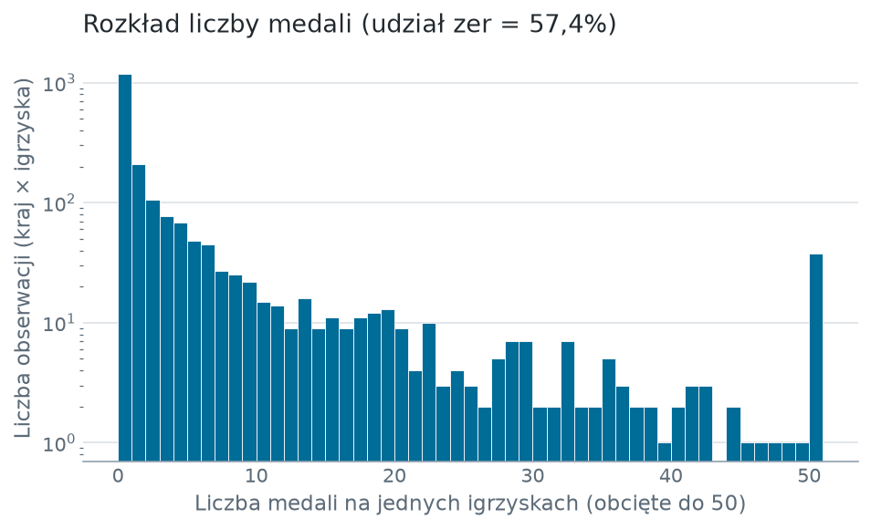
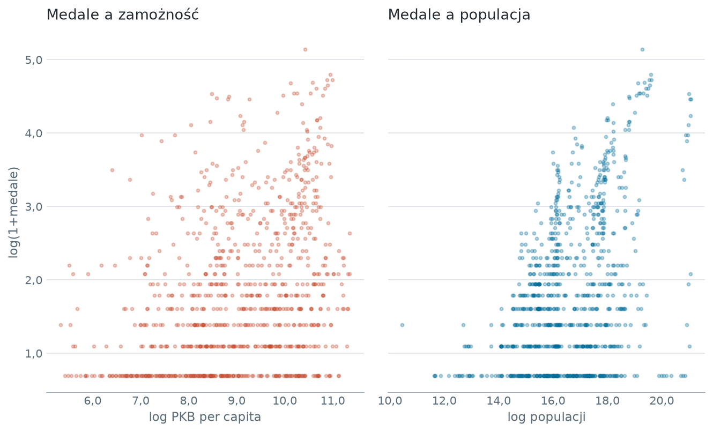
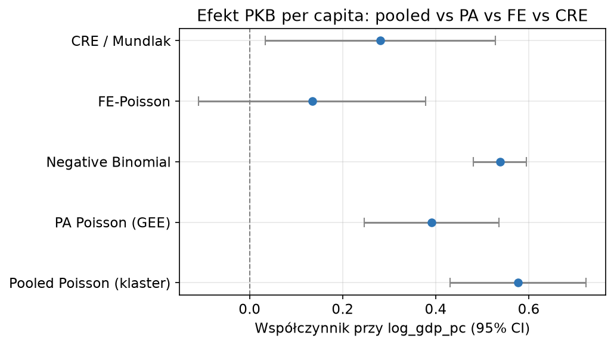

# Determinanty liczby medali olimpijskich - panelowe modele liczebności


Projekt szacuje, w jakim stopniu liczba medali zdobywanych przez kraj na letnich igrzyskach zależy od zamożności, wielkości populacji i roli gospodarza. Zmienna objaśniana jest liczbą zdarzeń, a ponad połowa obserwacji to zera, więc zastosowano rodzinę modeli liczebności: Poissona, ujemny dwumianowy i zero-inflated, w wariantach przekrojowym, uśrednionym po populacji oraz z efektami stałymi.

Punktem zainteresowania jest różnica między oszacowaniami: efekt zamożności mierzony między krajami jest ponad czterokrotnie większy od efektu mierzonego wewnątrz kraju w czasie.

## Pytanie badawcze

Czy wzrost PKB per capita przekłada się na większą liczbę medali, a jeśli tak, to czy zależność ta istnieje także wewnątrz pojedynczego kraju, czy wynika wyłącznie z porównania krajów między sobą.

## Dane

| | |
|---|---|
| Wyniki olimpijskie | zbiór *josephcheng123456* (Olympedia), poziom zawodnik × konkurencja |
| Wskaźniki makroekonomiczne | World Bank WDI: `NY.GDP.PCAP.KD` (PKB per capita, stałe USD 2015), `SP.POP.TOTL` (populacja) |
| Jednostka panelu | kraj (NOC) × letnie igrzyska |
| Zakres | 1960-2020, szesnaście edycji |
| Liczebność | 2 072 obserwacje, 193 kraje |

**Dane surowe nie są częścią repozytorium** - 95 MB i licencja dostawcy. Instrukcja pobrania w sekcji [Uruchomienie](#uruchomienie).

**Panel analityczny jest częścią repozytorium** (`data/processed/panel_analityczny.csv`, 197 KB). Pozwala powtórzyć wszystkie modele bez pobierania danych surowych; cały zestaw liczy się poniżej dwóch sekund.

### Rozkład zmiennej objaśnianej

Udział zer wynosi 57,4%, średnia 4,69 medalu, wariancja 172,25, maksimum 170 medali. Stosunek wariancji do średniej rzędu trzydziestu siedmiu wyklucza model Poissona z poprawnym wnioskowaniem bez korekty macierzy wariancji.



Oś liczebności jest w skali logarytmicznej. Bez tego słupek przy zerze przykrywa cały ogon rozkładu.



Przekrój ograniczono do obserwacji z co najmniej jednym medalem, ponieważ zera tworzyłyby linię przy dolnej krawędzi, która nie informuje o sile zależności.

## Decyzje projektowe

**Deduplikacja medali drużynowych.** Jeden medal to unikalna krotka `(edition_id, country_noc, event, medal)`. Bez tego drużyna jedenastu piłkarzy wnosiłaby jedenaście złotych medali, a dyscypliny zespołowe otrzymywałyby wagę proporcjonalną do liczebności składu.

**Panel budowany z uczestnictw, nie z medali.** Kraj, który wystartował i nie zdobył medalu, otrzymuje `medals = 0`. Lista medali pominęłaby te obserwacje, a model liczebności opiera się właśnie na nich.

**Ograniczenie do letnich igrzysk.** Daje panel o stałym odstępie czterech lat, zgodny z roczną częstotliwością WDI.

**Mapowanie NOC na ISO3.** Kody Olympedii różnią się od kodów Banku Światowego dla siedemdziesięciu siedmiu krajów (GER→DEU, NED→NLD, SUI→CHE, RSA→ZAF i dalsze). Słownik znajduje się w `src/data_load.py`. Test sprawdza, czy mapowanie jest jednoznaczne, ponieważ dwa kody wskazujące ten sam kraj scaliłyby dwie reprezentacje.

**Opóźniona zmienna zależna jako kontrola.** `medals_lag` to medale kraju na jego poprzednich letnich igrzyskach, wyznaczone przesunięciem wewnątrz kraju po uporządkowaniu po roku. Zmienna pełni rolę kontroli trwałości pozycji, nie przedmiotu wnioskowania.

**Błędy standardowe klastrowane po kraju.** Kolejne edycje tego samego kraju nie są niezależne.

## Specyfikacje

| Sekcja | Model                                     |
| ------ | ----------------------------------------- |
| 4a     | Poisson przekrojowy oraz ocena dyspersji  |
| 4b     | Poisson przekrojowy z macierzą klastrową  |
| 4c     | Ujemny dwumianowy (NB2)                   |
| 4d     | Poisson z efektami stałymi kraju i edycji |
| 4e     | Poisson uśredniony po populacji (GEE)     |
| 4f     | Poisson CRE z urządzeniem Mundlaka        |
| 4g     | Zero-inflated Poisson                     |

## Kluczowe wyniki

### Nadmierna dyspersja

Statystyka Pearsona wynosi 12 529,2 przy 2 067 stopniach swobody, co daje iloraz 6,062. Oszacowania współczynników pozostają zgodne, lecz błędy standardowe są błędne, co uzasadnia macierz klastrową, model ujemny dwumianowy oraz wariant zero-inflated.

Parametr dyspersji NB2 wynosi 1,478 przy błędzie standardowym 0,084. Porównanie dopasowania: Poisson 12 071,6, zero-inflated Poisson 9 402,5, ujemny dwumianowy 6 860,7 (AIC, wartości niższe oznaczają lepsze dopasowanie).

### Efekt zamożności zależy od tego, czym się go mierzy



| Estymator | Współczynnik `log_gdp_pc` | Błąd standardowy | IRR | IRR przy wzroście PKB o 10% |
|---|---|---|---|---|
| Poisson przekrojowy (klaster) | 0,577 | 0,074 | 1,781 | 1,057 |
| Negative Binomial | 0,538 | 0,029 | 1,712 | 1,053 |
| Poisson uśredniony (GEE) | 0,392 | 0,074 | 1,479 | 1,038 |
| Poisson CRE / Mundlak | 0,281 | 0,126 | 1,325 | 1,027 |
| Poisson z efektami stałymi | 0,135 | 0,124 | 1,144 | 1,013 |

Wszystkie wartości są oszacowaniami punktowymi; IRR to `exp(β)`, a dla zmiennych w logarytmach `β` przybliża elastyczność.

Oszacowanie spada z 0,577 w modelu przekrojowym do 0,135 po dodaniu efektów stałych kraju i edycji, gdzie traci istotność (p = 0,279). Efekt zamożności jest więc w przeważającej części efektem między krajami: kraje bogatsze zdobywają więcej medali, natomiast wzrost PKB per capita wewnątrz kraju w czasie nie przekłada się w sposób mierzalny na liczbę medali. Model CRE daje wartość pośrednią, 0,281.

**Liczebność w modelu z efektami stałymi wynosi 1 490, nie 2 072.** Poisson z efektami stałymi pomija kraje, które we wszystkich obserwowanych edycjach nie zdobyły medalu: przy zerowej zmiennej objaśnianej w całej grupie efekt stały kraju przyjmuje wartość graniczną i obserwacje nie wnoszą zmienności wewnątrzkrajowej. Dotyczy to sześćdziesięciu siedmiu krajów, czyli 582 obserwacji. W panelu nie ma krajów obserwowanych tylko raz, więc odrzucenie nie wynika z singletonów. Oszacowanie 0,135 opiera się zatem na podpróbie krajów medalowych.

### Populacja i rola gospodarza

| Zmienna | Poisson przekrojowy (klaster) | Poisson z efektami stałymi |
|---|---|---|
| `log_pop` | 0,531 (0,060) | 1,261 (0,314) |
| `host` | 0,435 (0,073) | 0,413 (0,083) |
| `medals_lag` | 0,011 (0,004) | 0,008 (0,003) |

W nawiasach błędy standardowe. Wszystkie trzy współczynniki pozostają dodatnie i istotne w obu specyfikacjach. Elastyczność względem populacji rośnie po wprowadzeniu efektów stałych do 1,261, co odpowiada IRR równemu 3,530. Rola gospodarza podnosi oczekiwaną liczbę medali o około połowę (IRR 1,512 w modelu z efektami stałymi).

### Test Mundlaka

Łączny test istotności średnich wewnątrzkrajowych daje χ² = 17,836 przy czterech stopniach swobody i p = 0,0013. Efekt stały kraju jest skorelowany z regresorami, więc estymator z efektami stałymi jest właściwszy od estymatora z efektami losowymi. Model CRE pozwala mimo to interpretować zmienne quasi-stałe.

### Model rekomendowany

Poisson z efektami stałymi kraju i edycji oraz macierzą klastrową po kraju. Efekty stałe kraju pochłaniają trwałą heterogeniczność, a efekty edycji wspólne szoki poszczególnych igrzysk, takie jak zmiany liczby konkurencji czy bojkoty.

## Struktura projektu

```
├── data/
│   ├── raw/                dane źródłowe, poza repozytorium (poza zapisanymi WDI)
│   └── processed/          panel analityczny, w repozytorium
├── notebooks/
│   └── 01_panel_medale.ipynb      narracja badania: budowa panelu, modele, tabele
├── src/
│   ├── data_load.py        wczytanie plików olimpijskich i WDI, mapowanie NOC na ISO3
│   ├── pre_processing.py   deduplikacja medali, zera, opóźnienie, łączenie z WDI
│   ├── model.py            siedem specyfikacji i ich estymacja
│   ├── inference.py        IRR, dyspersja, test Mundlaka, porównanie estymatorów
│   └── visualisation.py    wykresy i tabele publikacyjne, zapis do reports/
├── scripts/
│   └── run_models.py       przebieg modeli na gotowym panelu, wynik do reports/
├── reports/
│   ├── figures/            wykresy osadzone w tym pliku
│   ├── tables/             tabele publikacyjne w HTML
│   └── model_results.txt   pełny wydruk oszacowań
├── tests/                  gwarancje metodologiczne, opis w tests/README.md
└── requirements.txt, requirements-dev.txt, LICENSE, .gitignore
```

Logika obliczeniowa znajduje się w `src/`. Notebook ją wywołuje i opisuje.

## Uruchomienie

```bash
python -m venv venv
venv\Scripts\activate          # Windows; na Uniksie source venv/bin/activate
pip install -r requirements.txt
```


Powtórzenie wszystkich modeli na panelu dołączonym do repozytorium:

```bash
python scripts/run_models.py
```

Czas wykonania poniżej czterech sekund; wynik zapisuje się do `reports/model_results.txt`.

Przeliczenie całości od danych surowych wymaga ich pobrania. Zbiór *josephcheng123456* należy rozpakować do `data/raw/` tak, aby powstały pliki `Olympic_Athlete_Event_Results.csv` i `Olympics_Games.csv`. Następnie uruchamia się `notebooks/01_panel_medale.ipynb`, który odbudowuje panel i zapisuje go do `data/processed/`. Pełny przebieg notebooka zajmuje około siedmiu sekund.

Dane WDI są dołączone jako `data/raw/wdi_worldbank.csv`. Odświeżenie z API Banku Światowego wymaga pakietu `wbgapi` i wywołania `data_load.load_wdi(refresh=True)`; nieudane pobranie jest zgłaszane wprost, a nie zastępowane cichym odczytem zapisanej kopii.

## Testy

```bash
pip install -r requirements-dev.txt
pytest
```

Trzydzieści siedem testów, czas wykonania około dwóch sekund. Sprawdzane są gwarancje metodologiczne: deduplikacja medali drużynowych, obecność zer dla uczestników bez medalu, brak przecieku między krajami w opóźnieniu, jednoznaczność mapowania NOC na ISO3 oraz zgodność tabel wynikowych z oszacowaniami. Testy działają na próbie syntetycznej, bez danych źródłowych. Opis w [tests/README.md](tests/README.md), razem z wynikiem weryfikacji mutacyjnej.

## Ograniczenia

- Oszacowanie z efektami stałymi opiera się na 1 490 obserwacjach wobec 2 072 w modelach przekrojowych, ponieważ sześćdziesiąt siedem krajów bez medalu w całym okresie nie wnosi zmienności wewnątrzkrajowej. Porównanie współczynników między kolumnami dotyczy więc częściowo różnych podprób.
- `medals_lag` wprowadza opóźnioną zmienną zależną do modelu z efektami stałymi, co przy skończonej liczbie okresów prowadzi do obciążenia znanego z panelu dynamicznego. Zmienna pełni rolę kontroli, a wnioski dotyczą pozostałych współczynników.
- Panel obejmuje rok 2020, w którym igrzyska odbyły się w roku 2021. Dane WDI przypisano do roku edycji zgodnie z zapisem źródła.
- Pierwsza obserwacja każdego kraju wypada z próby z powodu braku w `medals_lag`.
- Panel jest niezbalansowany, a wejście i wyjście krajów - powstawanie i rozpad państw, bojkoty - zależy częściowo od czynników skorelowanych z wynikami.
- Pomiar zasobów ogranicza się do PKB per capita i populacji, pomijając nakłady bezpośrednio sportowe: finansowanie federacji i infrastrukturę. Modele nie uwzględniają także liczby wysłanych zawodników ani liczby konkurencji w danej edycji; efekty stałe edycji pochłaniają zmiany wspólne dla wszystkich krajów, lecz nie różnice w wielkości reprezentacji.

## Licencja

Kod na licencji MIT - zobacz [LICENSE](LICENSE). Licencja obejmuje wyłącznie kod autora; dane źródłowe podlegają warunkom swoich dostawców.
